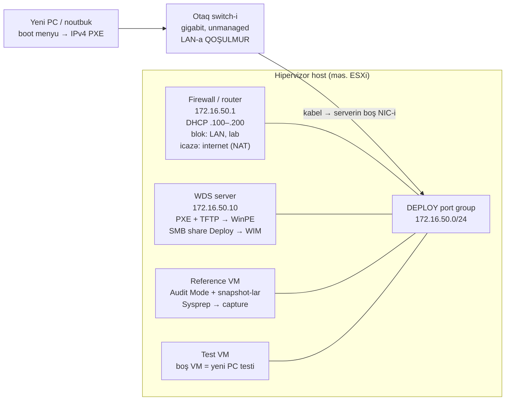

# 01 — Arxitektura və əsas anlayışlar

Bu sistem şirkətin kompüterlərinə təxminən 20–30 dəqiqəyə, əmr yazmadan, proqramları quraşdırılmış Windows 11 Pro
yazır. İş yalnız **izolə DEPLOY şəbəkəsində** gedir. Texnik yalnız Enter basır, `SIL` yazır və iki suala cavab verir.

> Bu sənəddəki IP-lər, adlar və dəyərlər **nümunədir**. Öz saytının dəyərlərini
> [02-implementation-guide.md](02-implementation-guide.md) faylındakı parametr cədvəlində doldur.

## Ümumi şəkil

## Niyə bu arxitektura?

- **MDT** artıq dəstəklənmir. **WDS** isə Windows 11 üçün köhnə "Install Images" yolunu bloklayıb: Windows 11 ISO-sundakı
  `boot.wim` WDS rejimində Setup işə salmır.
- WDS hələ də **istənilən custom WinPE-ni PXE ilə göndərə bilir**. Ona görə WDS-dən yalnız "taksi" kimi istifadə edirik:
  WinPE-ni kompüterə çatdırır. Image-i isə WinPE-nin içindəki skript adi bir SMB paylaşımından götürüb DISM ilə diskə yazır.
- SCCM/MDT də daxildə eyni məntiqlə işləyir: PXE → WinPE → task sequence → şəbəkə paylaşımından image.

## Əsas anlayışlar

| Anlayış | Nədir | Bu sistemdə |
| --- | --- | --- |
| **PXE** | Kompüterin diskdən yox, şəbəkədən açılması | Boot menyusunda "IPv4 Network" |
| **DHCP** | IP, gateway, DNS paylayan xidmət | Firewall/router-də. Option 60/66/67 YOX |
| **WDS** | PXE sorğusuna cavab verən və WinPE-ni TFTP ilə göndərən Windows Server rolu | Standalone rejim, domain lazım deyil |
| **TFTP** | Sadə, yavaş fayl ötürmə protokolu; PXE bununla işləyir | Yalnız boot.wim-i göndərir |
| **WinPE** | RAM-da işləyən kiçik Windows. Diski hazırlayır, image yazır və ya götürür | Bizim custom `boot.wim` |
| **Boot image** | Açılış üçün yüklənən WinPE (`boot.wim`) | "Yük maşını": Windows-u gətirib diskə yazır |
| **Install image** | Diskə yazılan əsl Windows (`.wim`) | `Win11-Base.wim` = bizim hazır Windows |
| **WIM / ESD** | Windows-un sıxılmış fayl qutusu; ESD daha sıx və yavaşdır | ISO-dakı `install.esd`-dən Pro çıxarılır |
| **DISM** | Image götürmək (`/Capture-Image`) və diskə yazmaq (`/Apply-Image`) aləti | WinPE-də işləyir |
| **Sysprep** | Kompüterə xas kimliyi (SID, ad, avadanlıq bağlılığı) silir, proqramlar qalır | Capture-dan əvvəl |
| **SID** | Windows-un hər kompüterə verdiyi unikal kimlik nömrəsi | Sysprep → hər PC yeni SID alır |
| **Audit Mode** | İstifadəçi yaratmadan Windows-u hazırlamaq rejimi | OOBE-də Ctrl+Shift+F3 |
| **OOBE** | İlk açılış ekranları (region, hesab və s.) | unattend.xml ilə keçilir |
| **unattend.xml** | İlk açılışda sualları avtomatik cavablandıran "cavab vərəqi" | Dil, saat, admin hesabı, AutoLogon |
| **ADK + WinPE add-on** | Microsoft-un deployment alətləri + WinPE-nin özü | boot.wim yığmaq üçün |

## Sysprep və Acronis klonu arasındakı fərq

- **Acronis klonu** eyni kompüterin surətidir: ad, SID, istifadəçilər, köhnə driver-lər qalır. Çox kompüterə yazılanda
  ad və SID konflikti, driver qarışıqlığı yaranır.
- **Sysprep olunmuş image** isə "fabrikdən yeni çıxmış Windows, amma proqramlar içində" deməkdir. Yeni PC-də
  "Getting devices ready" → OOBE (bizdə avtomatik) → masaüstü + proqramlar.
- Sysprep etmədən capture etsən, nəticə Acronis klonundan **fərqlənmir**. Fərqi alət yox, Sysprep yaradır.
- HP, Lenovo, Dell fabrikdə eyni şeyi edir: image + proqramlar → Sysprep → minlərlə noutbuka.

## Bir PC-nin yolu (texniki axın)

1. **PXE + DHCP.** Şəbəkə kartı DHCP sorğusu göndərir, firewall IP verir. WDS eyni şəbəkədə olduğu üçün PXE sorğusunu
   eşidir və **özü** cavab verir (proxyDHCP kimi). Ona görə DHCP option 60/66/67 lazım deyil. WDS Boot Manager
   Enter/F12 gözləyir.
2. **TFTP.** WDS `\Boot\x64\Images\boot.wim` faylını (bizim WinPE) kompüterin RAM-ına göndərir. WinPE-də X: = RAM diski.
3. **startnet.cmd** (boot.wim-in içində, avtomatik): `wpeinit` → şəbəkəni gözləyir → `net use Z: \\<WDS>\Deploy`
   (yalnız oxuma hüququ olan hesabla, 10 cəhd) → `Z:\Scripts\Deploy.ps1`.
4. **Deploy.ps1** (share-dən oxunur):
    1. Image, unattend.xml, FirstLogon.ps1 yerindədirmi yoxlayır.
    2. Daxili diski tapır: USB/SD xaric, ≥ 30 GB. Bir neçə daxili disk varsa, soruşur. Disk yoxdursa, VMD xəbərdarlığı verir.
    3. Diskdə Windows varsa, qırmızı xəbərdarlıq göstərir → `SIL` təsdiqi tələb edir (başqa cavab = heç nə edilmir).
    4. diskpart: clean → GPT → EFI 260 MB (FAT32, S:) → MSR 16 MB → Windows (NTFS, qalan yer, W:).
    5. `dism /Apply-Image` → `Z:\Images\Win11-Base.wim` → `W:\`.
    6. Serverdəki **ən son** unattend.xml → `W:\Windows\Panther\`, FirstLogon.ps1 → `W:\Deploy\`.
    7. `bcdboot W:\Windows /s S: /f UEFI` → açılış faylları.
    8. Log: `X:\deploy.log` → `W:\Deploy\deploy.log` → 15 saniyə sonra restart.
5. **İlk açılış (unattend.xml).** Windows yeni SID alır, avadanlığı tanıyır. Klaviaturalar, region, saat qurşağı
   avtomatik qurulur, OOBE ekranları gizlənir, lokal admin yaradılır və o hesabla bir dəfə avtomatik giriş edilir.
6. **FirstLogon.ps1** (adminin ilk girişində): AutoLogon şifrə qalıqlarını və unattend fayllarını silir → System Restore
   ON + restore point → dil siyahısı (yalnız seçilmiş dillər, yeni istifadəçilərə də kopyalanır) → yeni istifadəçilər
   üçün This PC + Control Panel ikonları → PC adı → standard istifadəçi → restart.

## Niyə SetupComplete.cmd yox?

BIOS-da OEM açarı olan kompüterlərdə (HP, Lenovo, ASUS, Dell) və Pro edition-da Windows `SetupComplete.cmd`-i **qəsdən
işə salmır** (Microsoft: "OEM license detected, will not run SetupComplete.cmd"). Ona görə unattend-in
`FirstLogonCommands` + `AutoLogon` cütlüyü istifadə olunur.

## Niyə skriptlər share-də, image-in içində yox?

Deploy.ps1 hər qurulumda unattend.xml-i və FirstLogon.ps1-i **serverdən** götürüb image-dəkinin üzərinə yazır.
Nəticə: şifrəni, dili, ilk giriş addımlarını dəyişmək üçün **image-ə toxunmaq lazım deyil**. Serverdəki faylı
dəyişirsən, növbəti kompüterdən qüvvəyə minir. Yalnız `startnet.cmd` boot.wim-in içindədir.

## Qovluqlar (WDS serverində)

| Qovluq | Nə üçün | Toxunmaq olar? |
| --- | --- | --- |
| `E:\ADK` | ADK (Deployment Tools) + WinPE add-on | Silmə: boot.wim-i yenidən qurmaq üçün lazımdır |
| `E:\WinPE_amd64` | boot.wim-in "emalatxanası": `media\sources\boot.wim` (mənbə) + `mount\` | Yalnız boot.wim yeniləyəndə |
| `E:\RemoteInstall` | WDS-in öz qovluğu: boot image-in nüsxəsi, BCD, ayarlar | Əl ilə **TOXUNMA**, yalnız WDS konsolu |
| `E:\Deploy\Images` | `Win11-Pro.wim` (boş Pro, reference üçün) · `Win11-Base.wim` (hazır) · `Archive\` | Image yeniləyəndə |
| `E:\Deploy\Scripts` | Deploy.ps1 · FirstLogon.ps1 · unattend.xml · startnet.cmd | Bütün dəyişikliklər burada |
| `E:\Deploy\Drivers` | `WinPE\` (boot.wim üçün) · `<Vendor>\<Model>\` | Yeni model gələndə |
| Share | `\\<WDS>\Deploy` → `E:\Deploy` | — |

## Hesablar

| Hesab | Harada | Hüquq / istifadə |
| --- | --- | --- |
| `svc_imaging` | WDS (lokal) | `E:\Deploy` üzrə yalnız oxuma (RX); şifrəsi startnet.cmd-də (boot.wim içində) |
| `Administrator` | WDS (lokal) | Capture zamanı share-ə YAZMAQ üçün |
| Lokal admin (məs. `ladmin`) | Hər yeni PC | unattend.xml yaradır; AD varsa → Windows LAPS |
| İstifadəçi | Hər yeni PC (standard user) | FirstLogon.ps1 yaradır (AD varsa yaradılmır) |
